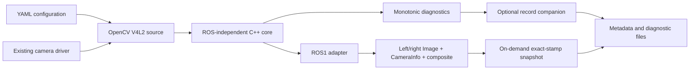

# Architecture

`ardustereo_core` contains image contracts, normalization/splitting, lifecycle and runtime monitoring. `ardustereo_opencv` provides the actual Linux V4L2 source and observed startup-control mapping. `ardustereo_ros` supplies standard messages and configuration/calibration validation. The Python companion adds metadata/snapshots without changing the C++ capture loop.

See [interfaces](interfaces.md) and [diagnostics](diagnostics.md) for timing and failure contracts. ROS2 remains a possible future adapter, not an implemented capability.
