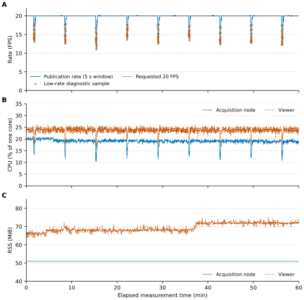

# Tested GUI candidate: evidence and reproduction

The archived hardware results below correspond to v0.3.0-startup-init-fix1. On v0.4.0, pass `--implementation-root /path/to/fix1-checkout` to the verifier to check the historical implementation hashes alongside the archived data. CI supplies that checkout at its original commit.

This directory publishes de-identified numeric evidence for `0.3.0-startup-init-fix1`, measured on2026-11-10. It is not an additional hardware run. Camera images, bags, device/network logs and private journals are excluded. Previous v0.2.2 data and its original strict no-WARN failure remain unchanged at [v0.2.2/validation](https://github.com/zhu-chengdong/ArduStereo/tree/v0.2.2/validation).

## Main results

The fixed3600s preview-active window produced71,188 complete five-topic groups at19.774444FPS. It includes133 low-publication-rate WARN samples, minimum fixed5s receive-bin rate11.4FPS,35 bins below19FPS, and maximum composite receive gap602.902661ms. No measurement-window empty-read, frame-rejection or read-exception counter increment was observed. These window statements do not remove shutdown-boundary empty reads or the final partial message group outside the window.

The predeclared scoped criteria were mean19–21FPS, no receive gap>2s and no window read/format faults, with low-rate warnings separately retained. The result is `PASS_SCOPED_FINAL_EXPERIMENTS_WITH_RATE_WARNINGS`, not strict-no-WARN or sensor-zero-loss success. The viewer's first/last5min RSS increased66.24503→71.93011MiB. See [summary](gui-fix1/summary.json) and the complete time series below.



The chart shows every diagnostic sample and all133 WARN points, plus capture/viewer resource samples. It does not smooth away dips. CPU100%=one logical core, RSS inMiB. No replicate error bars are invented from this single run.

## Public inputs and checks

```bash
python3 validation/gui-fix1/verify_results.py
```

The checker uses Python's standard library only and no camera/ROS process. It checks data hashes, the frozen implementation,71,188 composite relative arrivals, full-window FPS, maximum gaps including edges, fixed5s bins,3600 diagnostics including133 WARN samples, and1766 resource samples per role. It independently recomputes CPU/RSS summaries from the published tables. The five-topic complete-group count and image/control/replay checks are retained as author-run summary evidence, not claimed to be reconstructed solely from a composite arrival table.

`arrivals.csv.gz` contains every composite arrival in the original half-open hour window. Nanoseconds are relative to the window start, with absolute clock and device identifiers removed. `diagnostics.csv` contains unchanged5s sliding publication rates sampled each second. `resources.csv` contains capture/viewer CPU andRSS at original relative sample times. Fixed bins and sliding windows are different metrics. `data-manifest.json` identifies source SHA256 values and transformations; `implementation-manifest.json` identifies the exact tested source subset. Published numeric tables and original software are under the repository MIT license; third-party licenses are unchanged.

## Additional real checks and retained qualifications

The short GUI test verified exposure681→340→681, gain100→200→100 and20→10→20FPS in a fixed scene. The400×400 ROI atx100/y100 was subsampled consistently. Exposure restoration changed left/right ROI means+0.2971%/+0.3575%; gain restoration−0.16594%/−0.16540%. Gain200 caused partial saturation and was a response test, not a recommended optimal exposure. Eight raw snapshot pairs and two saved YAML files were verified locally.

A network interruption in that short test and subsequent USB connection recovery are separate sessions; they were not stitched into the continuous hour. The same tested binary was used. The short-test subscriber/pub count difference17 was retained locally, not called zero sensor loss. The full hour has its own independent window and logs.

New/legacy comparisons used the same GREY2560×800 and raw20/681/100, each120s/2400composite messages. The legacy baseline is the preserved one-line GREY adaptation because the untouched original selectedY16. Its SHA256 is`275f74b148e06c0a8d4a2d943c414b04c8c7f832b20b0315a9217d8a3e9b2945`. The first legacy attempt incorrectly used ROS registration as readiness; startup then reset rate to50. It failed the input gate before timing. A separate successful attempt waited for a real first image, used the same binary, then set controls. This was a test-harness readiness problem, not evidence of hardware damage or an assigned user mistake.

Initial offline analysis incorrectly failed every `degraded` state, including the allowed rate-only WARN. The original report/script were retained. Classification was corrected only for the exact level1 low-rate message without an error stage; the original data, rate/gap thresholds and133 warnings were unchanged. Other degraded/error states still fail. Seven offline checks covered the correction; no camera rerun was used to replace the hour.

Two GUI stops were natural, about1.231/1.244s, and restart was checked. A separate external10s rosbag command produced9.774503s of messages:196 in each of four stereo topics and11 diagnostics. With the camera stopped, actual0.5× replay received all196 groups and had zero aligned complete-serialized-payload SHA mismatches. This does not establish real-time1× long replay, SLAM accuracy, calibration or physical exposure synchronization.

Figure-making used the scientific-visualization workflow for faithful traces and export checks. Tool-library provenance: Kassis et al., *Scientific Agent Skills: A Library of Procedural Knowledge for Research Agents*,2026,[arXiv](https://arxiv.org/abs/2609.00065). This is a figure-tool attribution, not validation evidence for ArduStereo.
